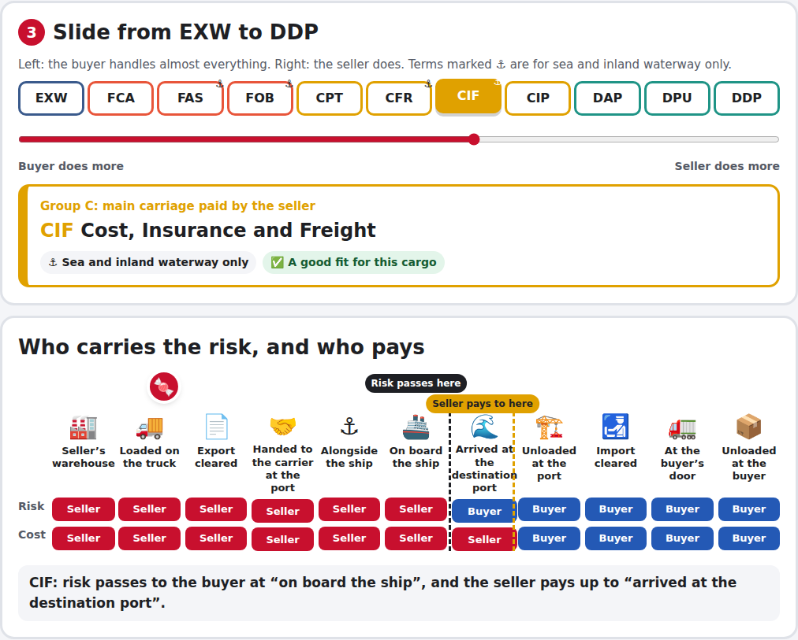
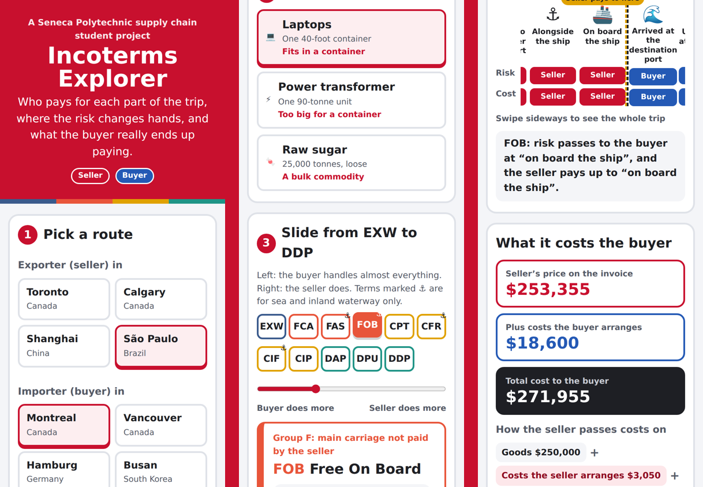

# Incoterms Explorer

**Who pays for each part of the trip, where the risk changes hands, and what the buyer really ends up paying.**

**[Try it](https://markfourman.github.io/incoterms-explorer/)** on your phone or computer. No sign-up, nothing to install.

## How to play

1. **Pick a route.** Choose where the exporter (seller) and importer (buyer) are. Two Canadian cities make a domestic move with no ocean and no customs. Anything else goes overseas.
2. **Pick the cargo:** laptops in a container, a 90-tonne power transformer that's too big for a container, or 25,000 tonnes of loose raw sugar.
3. **Slide from EXW to DDP.** Watch the risk handoff and the "seller pays to here" point move along the trip, and see the seller's price, the buyer's extra costs and the total change.

## What it teaches

- **All 11 Incoterms® 2020 rules.** FAS, FOB, CFR and CIF are for sea and inland waterway only, so they switch off on a domestic route.
- **Risk point vs cost point.** With C-terms, risk passes at the start but the seller pays freight to the destination: two critical points.
- **Right term, right cargo.** Sea-only terms suit bulk and oversized cargo loaded straight onto the ship. Containers are better on FCA, CPT or CIP.
- **Common mistakes.** "FOB" is often used for containers when FCA fits better. EXW often ends up with the seller loading the truck anyway.
- **Sellers pass costs on.** Whatever the seller arranges shows up in its price, with a margin you can adjust.
- **Changes in 2020:** DAT became DPU, and CIP now needs higher insurance cover than CIF.
- A five-question quiz at the end.

## How it's built

Plain HTML, CSS and JavaScript, with no frameworks. The rules live in `js/model.js`, separate from the screen code in `js/app.js`, so they can be tested on their own. `node tests/model-test.js` checks all 480 combinations of route, cargo and Incoterm: who loads under EXW, who pays duties under DDP, the two critical points of the C-terms, and that every cost adds up.

## Notes

Costs are simplified, illustrative estimates for learning; real quotes depend on the lane, the carrier, the season and the product's tariff classification. Incoterms® is a registered trademark of the International Chamber of Commerce. This project isn't affiliated with the ICC or Seneca Polytechnic.

## About

Made by [Mark Fourmanovskis](https://www.linkedin.com/in/mark-fourmanovskis/), Supply Chain Management student at Seneca Polytechnic. More projects: [Cargo Voyage](https://markfourman.github.io/cargo-voyage/) and [Supply Chain Workbook](https://markfourman.github.io/supply-chain-workbook).

MIT License.
